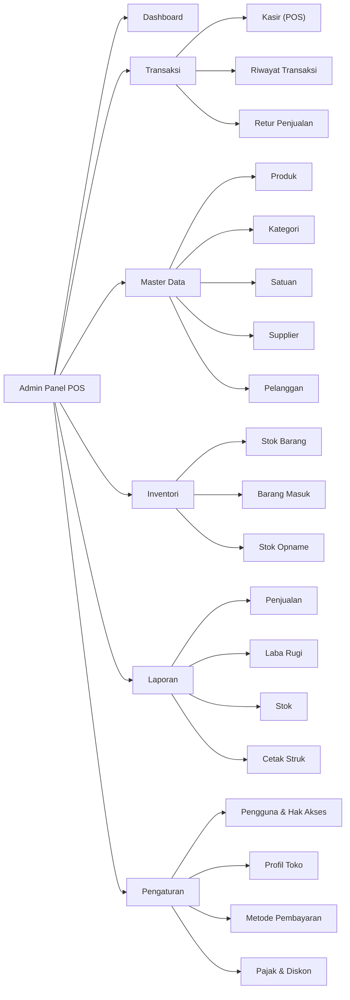
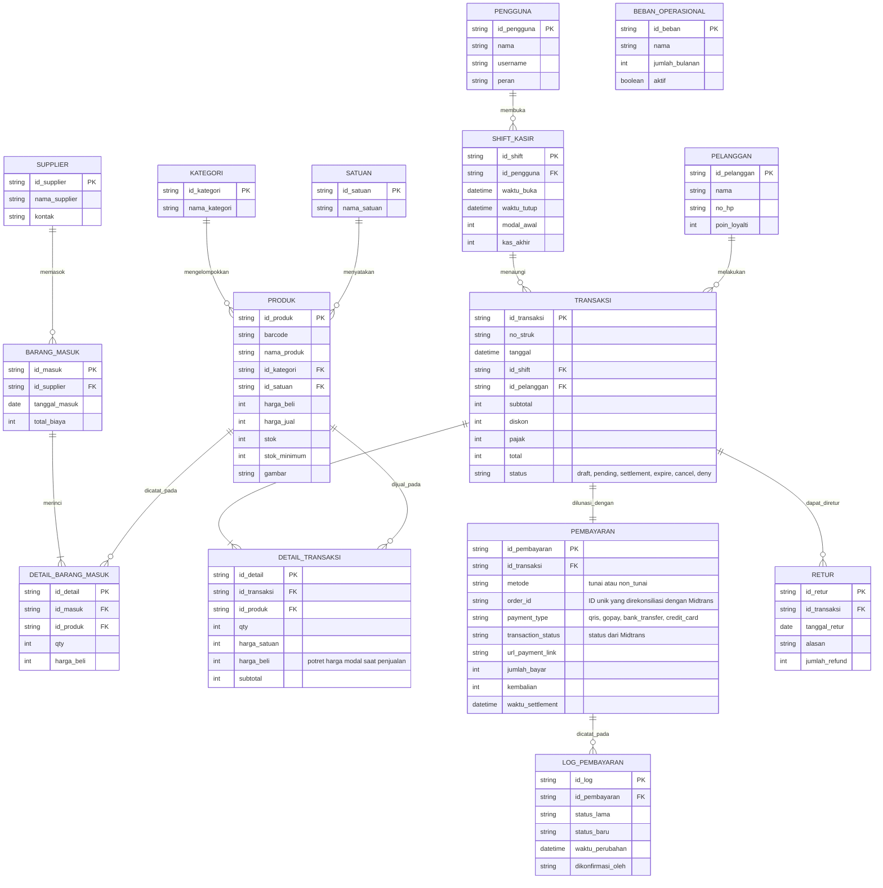
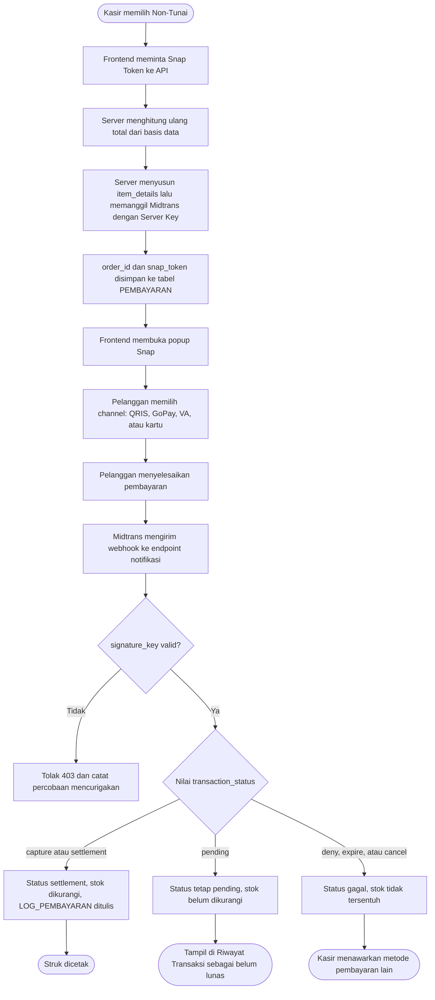
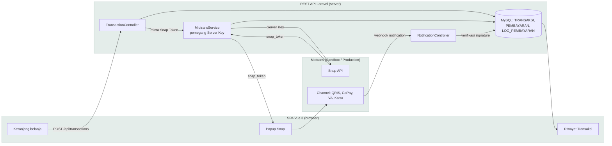
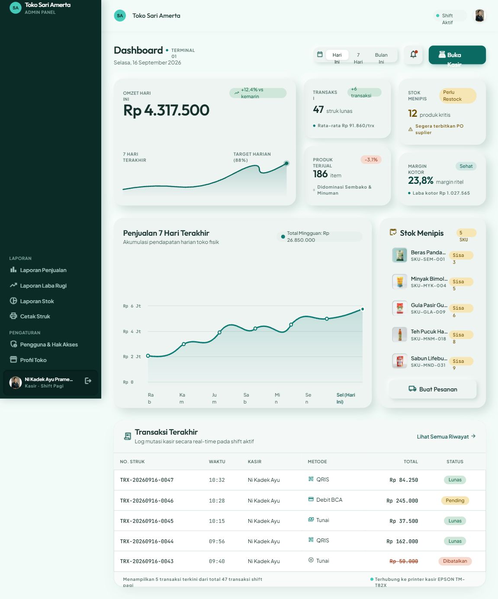
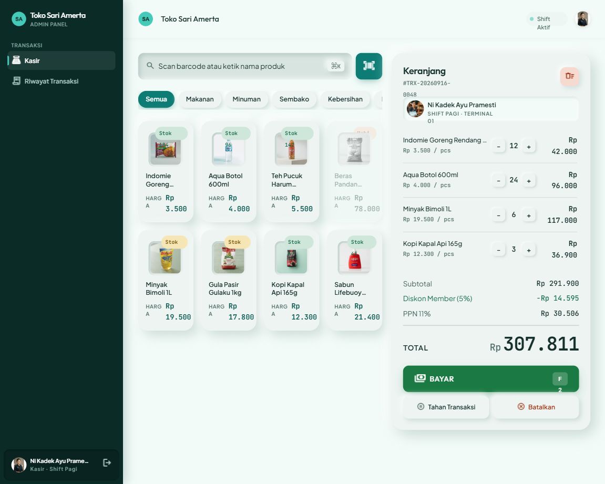
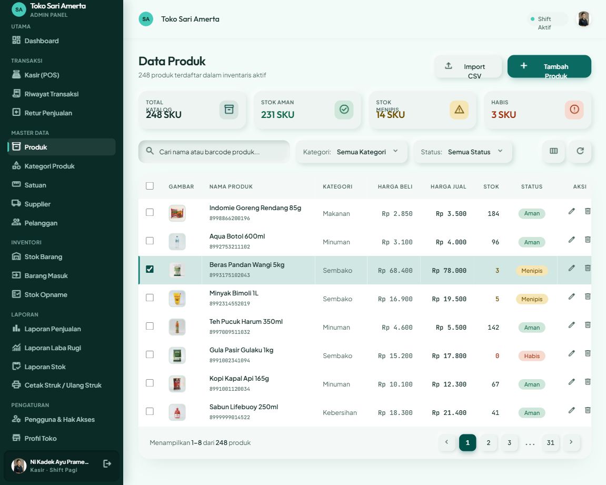
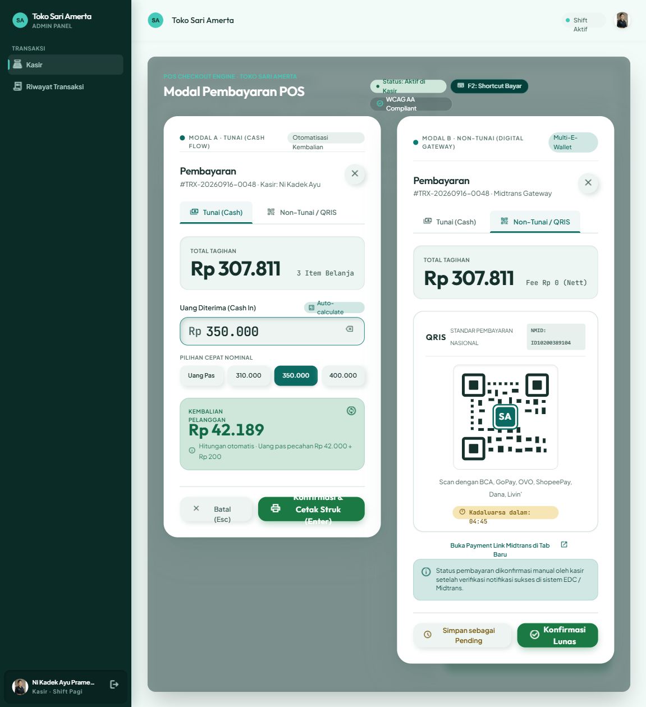
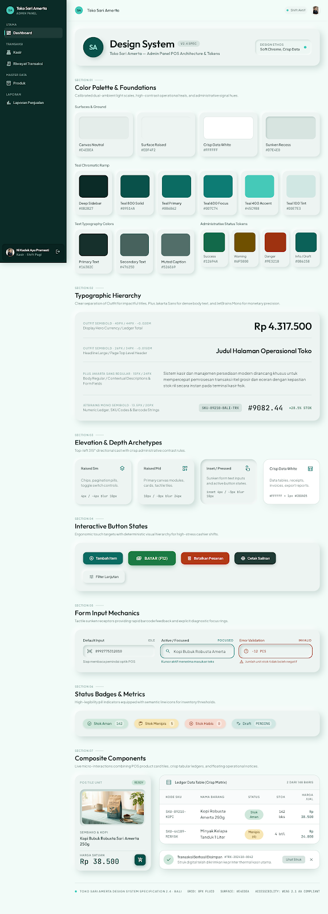
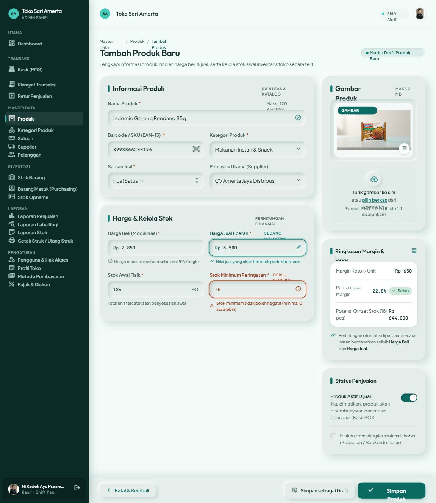

# PERANCANGAN — Admin Panel Point of Sales (POS / Kasir Toko)

> **Mata Kuliah:** Pemrograman Web 2 (Client-Side Programming)
> **Milestone:** 1 — Perencanaan Menu & UI Wireframing (Pekan Ke-3)

| Item | Keterangan |
| :-- | :-- |
| Nama | I GEDE YOGA SETIAWAN |
| NIM | 231011401028 |
| No. Presensi | 5 |
| Topik Sistem | Sistem Point of Sales (POS / Kasir Toko) |
| Tema Visual | **Neumorphism — Teal Soft UI** |
| Url Stitch | https://stitch.withgoogle.com/projects/11214029862213967469 |

---

## 1. Deskripsi Sistem

Admin Panel ini adalah *back-office* untuk sebuah toko retail. Sistem melayani dua kebutuhan yang karakternya berbeda, dan perbedaan itu memengaruhi keputusan desain di dokumen ini:

1. **Operasional kasir (front-line)** — transaksi harus selesai dalam hitungan detik. Halaman Kasir dioptimalkan untuk kecepatan: target sentuh besar, jalur keyboard, minim klik.
2. **Manajerial (back-office)** — pemilik toko memantau stok, penjualan, dan laba. Halaman ini dioptimalkan untuk keterbacaan data padat.

Sistem dibangun dalam dua tahap. **Tahap 1 (Milestone 1–3)** adalah prototipe *client-side* murni: HTML/CSS/JS dengan *mock data* di `localStorage`, tanpa back-end — inilah yang dinilai pada rubrik mata kuliah. **Tahap 2 (lanjutan)** mengangkat prototipe tersebut menjadi aplikasi penuh: REST API Laravel di atas MySQL, dengan SPA Vue 3 sebagai antarmukanya.

Dokumen ini merancang keduanya. Bagian 2–4 berlaku untuk kedua tahap karena menyangkut menu, data, dan alur kerja. Bagian 5 dan Bagian 11 khusus menjelaskan Tahap 2, sedangkan Bagian 6–9 adalah rancangan antarmuka yang dipakai bersama.

**Pembayaran non-tunai** memakai payment gateway **Midtrans Snap**. Rinciannya dibahas di Bagian 5.

---

## 2. Hirarki Menu (Sidebar / Navbar)

```
Admin Panel POS
│
├── 📊 Dashboard
│
├── 🛒 Transaksi
│   ├── Kasir (POS)              <- halaman operasional utama
│   ├── Riwayat Transaksi
│   └── Retur Penjualan
│
├── 📦 Master Data
│   ├── Produk
│   ├── Kategori Produk
│   ├── Satuan
│   ├── Supplier
│   └── Pelanggan
│
├── 🏬 Inventori
│   ├── Stok Barang
│   ├── Barang Masuk (Purchasing)
│   └── Stok Opname
│
├── 📈 Laporan
│   ├── Laporan Penjualan
│   ├── Laporan Laba Rugi
│   ├── Laporan Stok
│   └── Cetak Struk / Ulang Struk
│
└── ⚙️ Pengaturan
    ├── Pengguna & Hak Akses
    ├── Profil Toko
    ├── Metode Pembayaran
    └── Pajak & Diskon
```

### 2.1 Diagram Hirarki Menu



### 2.2 Hak Akses per Peran

| Menu | Admin / Pemilik | Kasir |
| :-- | :--: | :--: |
| Dashboard | ✅ | ➖ (versi ringkas) |
| Kasir (POS) | ✅ | ✅ |
| Riwayat Transaksi | ✅ semua | ✅ shift sendiri |
| Retur Penjualan | ✅ | ⚠️ perlu approval |
| Master Data | ✅ | ❌ |
| Inventori | ✅ | 👁️ lihat saja |
| Laporan | ✅ | ❌ |
| Pengaturan | ✅ | ❌ |

---

## 3. Rancangan ER-D (Entity Relationship Diagram)



---

## 4. User Flow

### 4.1 Alur Utama — Proses Transaksi Kasir


### 4.2 Alur Pendukung — CRUD Master Produk


### 4.3 Alur Pembayaran Non-Tunai (Midtrans Snap)



> **Tiga aturan yang mengikat implementasi.** Pertama, **stok hanya berkurang saat webhook `settlement` diterima** — bukan saat Snap Token dibuat, sebab transaksi yang batal akan memakan stok. Kedua, **webhook wajib idempoten**: Midtrans mengirim notifikasi yang sama berkali-kali, sehingga tanpa penjagaan stok dapat berkurang dua kali. Ketiga, **body webhook tidak pernah dipercaya tanpa verifikasi `signature_key`** — endpoint ini publik dan siapa pun dapat mengirim POST palsu yang mengaku `settlement`.

---

## 5. Integrasi Payment Gateway (Midtrans Snap)

### 5.1 Pilihan Arsitektur

Midtrans menyediakan beberapa jalur integrasi. Karena sistem ini memiliki back-end Laravel, **Snap** dipilih sebagai jalur utama.

Kunci keputusannya ada pada **Server Key**. Snap membuat token pembayaran lewat permintaan yang diautentikasi dengan Server Key, dan dokumentasi Midtrans menegaskan kunci itu hanya boleh dipakai dari sisi server. Syarat tersebut kini terpenuhi: Server Key disimpan di berkas `.env` pada server, tidak pernah dikirim ke browser, dan tidak pernah masuk repositori.

| Aspek | **Snap (dipakai)** | Core API | Payment Link |
| :-- | :-- | :-- | :-- |
| Letak Server Key | Server, aman | Server, aman | Tidak dipakai |
| Pembuatan transaksi | Otomatis via API | Otomatis via API | Manual dari dashboard |
| Nominal | Dinamis dari basis data | Dinamis dari basis data | Diketik manual |
| Rincian item / SKU | **Terkirim** | Terkirim | Tidak bisa |
| Pilihan channel | Semua, dalam satu popup | Ditangani satu per satu | Semua |
| Rekonsiliasi status | **Webhook otomatis** | Webhook otomatis | Manual |
| Beban implementasi | Ringan | Berat | Paling ringan |

Core API memberi kendali penuh atas tampilan tiap channel, tetapi menuntut penanganan terpisah untuk QRIS, VA, GoPay, dan kartu. Beban itu belum sebanding dengan manfaatnya pada tahap ini. Karena seluruh pemanggilan SDK dibungkus dalam satu *service layer* (§11.3), perpindahan ke Core API di kemudian hari tidak perlu menyentuh controller.

### 5.2 Arsitektur Alur Data



Berbeda dengan rancangan *client-side* sebelumnya, kini **ada panah balik dari Midtrans ke aplikasi**. Panah itulah yang menghapus kebutuhan konfirmasi manual oleh kasir.

### 5.3 Batasan yang Disadari

1. **Hanya mode Sandbox selama pengembangan.** Sistem tidak memproses uang sungguhan. Akun production memerlukan verifikasi bisnis.
2. **Webhook memerlukan URL publik.** Saat pengembangan di `localhost`, Midtrans tidak dapat menjangkau server sehingga dibutuhkan terowongan seperti ngrok. Endpoint `GET /api/transactions/{id}/status` disediakan sebagai cadangan bila webhook terlambat.
3. **Production menuntut HTTPS.** Midtrans menolak mengirim webhook ke alamat non-HTTPS.

### 5.4 Aturan Keamanan

| Aturan | Alasan |
| :-- | :-- |
| **Server Key hanya di `.env` server** | Repositori publik; kunci ini dapat menyalahgunakan akun merchant |
| **`.env` wajib masuk `.gitignore`** | Sekali ter-commit, kunci harus dicabut dan diganti |
| **Setiap webhook diverifikasi `signature_key`** | SHA512(`order_id` + `status_code` + `gross_amount` + ServerKey); tanpa ini siapa pun dapat memalsukan status lunas |
| **Nominal dihitung ulang di server** | Total kiriman frontend hanya pembanding, tidak pernah langsung disimpan |
| **Hanya Client Key yang boleh ke browser** | Client Key memang dirancang untuk publik dan tidak dapat mengubah transaksi |
| Hanya kredensial **Sandbox** selama pengembangan | Menghindari pemrosesan dana nyata |
| Tidak menyimpan data kartu di sisi aplikasi | Seluruh input sensitif ditangani di halaman Midtrans |

### 5.5 Dampak pada Rancangan Antarmuka

- **Modal Pembayaran** menyediakan dua metode. *Tunai* menampilkan input nominal dan kembalian; *Non-Tunai* memanggil `window.snap.pay(token)` sehingga pelanggan memilih channel di dalam popup Midtrans.
- **Keempat callback Snap ditangani**: `onSuccess`, `onPending`, `onError`, dan `onClose`. Status akhir tetap menunggu webhook, karena callback di browser dapat dimanipulasi.
- **Badge status transaksi** memakai warna pada §6.2: `settlement` hijau, `pending` kuning, `expire`/`cancel`/`deny` merah.
- **Halaman Riwayat Transaksi** menyediakan filter status agar transaksi `pending` mudah ditindaklanjuti, beserta tombol "Periksa Status" yang memanggil endpoint cadangan.
- **Menu Pengaturan → Metode Pembayaran** menyimpan Client Key dan sakelar aktif/nonaktif metode non-tunai. Server Key **tidak pernah** ditampilkan di antarmuka.

---

## 6. Design System — Neumorphism

### 6.1 Prinsip Neumorphism yang Dipakai

Neumorphism membangun kedalaman dari **dua bayangan berlawanan arah** pada permukaan sewarna dengan latar, bukan dari perbedaan warna. Konsekuensinya:

- Latar **tidak boleh** putih murni atau hitam murni — bayangan terang butuh ruang untuk terlihat.
- Permukaan neumorphic memakai warna dasar yang sama (`--surface-base`); yang membedakan hanya arah bayangan.
- Sumber cahaya konsisten dari **kiri-atas** di seluruh aplikasi, tanpa kecuali.
- **Satu pengecualian yang disengaja:** tabel data, modal, dan struk memakai `--surface-crisp` (`#FFFFFF`) dengan bayangan tajam, bukan neumorphic. Pada permukaan padat-data, keterbacaan menang atas kelembutan — alasannya diuraikan di §6.7.

### 6.2 Color Palette

Basis permukaan: **`#E4EDEA`** — hijau-teal sangat pucat, bukan abu-abu netral. Pilihan ini disengaja: basis netral membuat aksen teal terasa menempel dari luar, sedangkan basis yang sudah membawa sedikit teal membuat tombol dan sidebar terbaca sebagai bagian dari sistem yang sama. Seluruh rasio di bawah dihitung dengan rumus *relative luminance* WCAG 2.1 dan memenuhi **AA (minimal 4,5:1)**.

**Permukaan & bayangan**

| Token | HEX | Fungsi |
| :-- | :-- | :-- |
| `--surface-base` | `#E4EDEA` | Kanvas aplikasi + semua permukaan neumorphic |
| `--surface-raised` | `#EDF4F2` | Panel yang perlu naik sedikit (panel keranjang kasir) |
| `--surface-crisp` | `#FFFFFF` | Tabel data, modal, struk |
| `--surface-sunken` | `#D7E4E0` | Dasar *well*, track slider, area drop |
| `--shadow-light` | `#FFFFFF` | Sorotan kiri-atas |
| `--shadow-dark` | `rgba(122,152,145,·)` | Bayangan kanan-bawah, bertinta teal |
| `--divider` | `#CBDAD5` | Garis pemisah 1px |

**Teks**

| Token | HEX | Rasio vs base | Status |
| :-- | :-- | :--: | :--: |
| `--text-primary` | `#16302C` | 11,79:1 | AAA |
| `--text-secondary` | `#47625D` | 5,55:1 | AA |
| `--text-muted` | `#526E69` | 4,64:1 | AA |

**Skala teal (warna utama)**

| Token | HEX | Rasio vs base | Dipakai untuk |
| :-- | :-- | :--: | :-- |
| `--teal-950` | `#0B2B27` | 12,67:1 | Permukaan sidebar |
| `--teal-800` | `#09514A` | 7,69:1 | *Hover* tombol primary |
| `--teal-700` | `#0B6B62` | 5,34:1 | Isian tombol primary |
| `--teal-600` | `#0D7C74` | 4,24:1 | Focus ring, border aktif, ikon aksen |
| `--teal-400` | `#45C9B8` | — | Indikator terang **hanya di atas sidebar gelap** |
| `--teal-100` | `#D0E7E3` | — | Latar tint, baris terpilih, badge info |

**Isian tombol (teks putih di atasnya)**

| Token | HEX | Rasio vs putih | Dipakai untuk |
| :-- | :-- | :--: | :-- |
| `--btn-primary` | `#0B6B62` | 6,38:1 | Simpan, Tambah |
| `--btn-success` | `#1B7A43` | 5,37:1 | **BAYAR**, Konfirmasi |
| `--btn-danger` | `#B23A16` | 5,98:1 | Hapus, Batalkan |
| `--btn-neutral` | `#1F3A35` | 12,25:1 | Cetak, aksi sekunder |

**Warna status & badge**

| Status | Teks | Latar badge | Rasio | Ikon pendamping |
| :-- | :-- | :-- | :--: | :-- |
| Stok aman / `settlement` | `#12694A` | `#CFE7DB` | 5,12:1 | check-circle |
| Stok menipis / `pending` | `#6F5000` | `#F7E6B5` | 6,00:1 | clock |
| Stok habis / `expire` `cancel` | `#9E3210` | `#F6DACF` | 5,43:1 | x-circle |
| Info / `draft` | `#0B6158` | `#D0E7E3` | 5,66:1 | file-dashed |

**Sidebar (di atas `#0B2B27`)**

| Token | HEX | Rasio | Fungsi |
| :-- | :-- | :--: | :-- |
| `--sidebar-idle` | `#A8C6C0` | 8,28:1 | Item menu tidak aktif |
| `--sidebar-active` | `#FFFFFF` | 15,12:1 | Item menu aktif |
| `--sidebar-label` | `#7FA39D` | 5,49:1 | Label grup |
| `--sidebar-indicator` | `#45C9B8` | 7,41:1 | Batang penanda 3px di kiri item aktif |

**Palet grafik (Chart.js, Dashboard)**

| Urutan | HEX | Rasio vs base | Pemakaian |
| :--: | :-- | :--: | :-- |
| 1 | `#0B6B62` | 5,34:1 | Penjualan (deret utama) |
| 2 | `#2B5C78` | 6,06:1 | Pembanding / periode lalu |
| 3 | `#9A6B06` | 3,93:1 | Deret ketiga |
| 4 | `#B23A16` | 5,01:1 | Deret keempat |

> ⚠️ **Dua aturan yang tidak boleh dilanggar.** Pertama, **bayangan bukan pembawa informasi** — kontrasnya terhadap base jauh di bawah ambang AA, dan memang disengaja begitu. Jangan pernah menandai batas input, menu aktif, atau state error hanya lewat bayangan; selalu tambahkan pembeda kedua berupa warna teks, ikon, atau border. Kedua, **`--teal-400` tidak pernah dipakai di atas kanvas terang** (rasionya hanya 1,9:1 di sana); warna itu eksklusif milik sidebar gelap.

### 6.3 Typography

Tiga keluarga font, semuanya tersedia di Google Fonts sehingga Stitch dan Figma sama-sama mengenalinya.

| Keluarga | Peran | Alasan pemilihan |
| :-- | :-- | :-- |
| **Outfit** | Judul & angka display | Geometris dan berkarakter pada bobot 500–600 |
| **Plus Jakarta Sans** | Teks isi, label, tabel | Terbaca sangat baik pada 13–16px |
| **JetBrains Mono** | Kolom angka | Lebar digit seragam mutlak — wajib untuk kolom harga |

| Peran | Font | Size / Line-height | Weight | Tracking |
| :-- | :-- | :-- | :--: | :-- |
| Display — total belanja | Outfit | 40 / 44 | 600 | −0,02em |
| H1 — judul halaman | Outfit | 26 / 34 | 600 | −0,015em |
| H2 — judul section | Outfit | 20 / 28 | 600 | −0,01em |
| H3 — judul kartu | Outfit | 16 / 24 | 500 | 0 |
| Body — teks umum | Plus Jakarta Sans | 15 / 24 | 400 | 0 |
| Small — label & sel tabel | Plus Jakarta Sans | 13,5 / 20 | 400 | 0 |
| Overline — label grup | Plus Jakarta Sans | 11 / 16 | 600 | +0,08em, UPPERCASE |
| Caption — helper & error | Plus Jakarta Sans | 12 / 18 | 500 | 0 |
| **Numerik tabel** | JetBrains Mono | 13,5 / 20 | 500 | 0 |

**Aturan angka (kritis untuk POS).** Pembagian tugasnya disengaja: **angka hero** (total belanja, kartu omzet) memakai Outfit 600 dengan `font-variant-numeric: tabular-nums`, sedangkan **angka data** (kolom harga, stok, subtotal) memakai JetBrains Mono 500 rata kanan — kasir memindai kolom secara vertikal, jadi presisi mengalahkan keanggunan. Format Rupiah konsisten `Rp 4.317.500` (spasi setelah `Rp`, pemisah ribuan titik, tanpa desimal), dengan prefiks `Rp` diberi `--text-muted` berukuran 0,8em agar mata langsung tertuju ke nominalnya.

> **Font `Inter` sengaja tidak dipakai** karena sudah menjadi bawaan hampir semua template dan ciri khasnya nol. **Font serif dilarang total** di seluruh aplikasi.

### 6.4 Spacing & Radius

- Skala spacing kelipatan **4px**: `4 · 8 · 12 · 16 · 24 · 32 · 48 · 64`
- Padding dalam kartu neumorphic `24px` (minimum `16px` — bayangan butuh ruang agar tidak terpotong)
- Jarak antar kartu `20px` · padding sel tabel `14px 16px` · tinggi baris tabel `52px`
- Padding halaman `32px` di desktop, `16px` di mobile

| Elemen | Radius |
| :-- | :-- |
| Tombol, input, select | `14px` |
| Kartu, panel | `24px` |
| Modal | `28px` |
| Kartu produk (grid kasir) | `20px` |
| Item sidebar | `12px` |
| Badge, chip, avatar | `999px` (pil penuh) |

**Grid & breakpoint.** Sidebar `260px`, menyusut jadi `72px` (ikon saja) di bawah `1280px`. Konten utama dibatasi `max-width: 1440px`. Breakpoint `sm 640 · md 768 · lg 1024 · xl 1280 · 2xl 1536`. **Semua layout asimetris wajib runtuh jadi satu kolom di bawah `768px`**, tanpa *horizontal scroll* pada body — tabel lebar dibungkus kontainer `overflow-x: auto` sendiri. Tinggi penuh memakai `min-height: 100dvh`, bukan `100vh`, karena satuan `vh` melompat di Safari iOS.

### 6.5 Resep Bayangan per State

Bayangan gelap **bertinta teal**, bukan abu-abu netral. Inilah yang membuat kedalaman terasa menyatu dan tidak kotor.

| State | `box-shadow` |
| :-- | :-- |
| **Raised sm** — badge, chip, tombol kecil | `4px 4px 10px rgba(122,152,145,.30), -4px -4px 10px rgba(255,255,255,.90)` |
| **Raised md** — kartu, tombol sekunder | `10px 10px 24px rgba(122,152,145,.32), -8px -8px 20px rgba(255,255,255,.92)` |
| **Raised lg** — modal, popover | `24px 24px 60px rgba(90,120,113,.28), -16px -16px 40px rgba(255,255,255,.90)` |
| **Inset** — input, tombol toggle aktif | `inset 4px 4px 10px rgba(122,152,145,.38), inset -3px -3px 8px rgba(255,255,255,.85)` |
| **Crisp** — permukaan putih (tabel, struk) | `0 18px 40px -18px rgba(22,48,44,.14), 0 0 0 1px rgba(203,218,213,.80)` |
| **Flat** — baris tabel | `none`, hanya `border-bottom: 1px solid #CBDAD5` |
| **Focus** | `0 0 0 1.5px #0D7C74, 0 0 0 5px rgba(13,124,116,.24)` |

**Motion.** Satu kurva untuk seluruh aplikasi: `cubic-bezier(0.16, 1, 0.3, 1)` dengan durasi `140ms` (tekan), `220ms` (hover), dan `340ms` (modal). Saat `:active`, permukaan `scale(.985)` dan bayangannya berubah menjadi inset sehingga benar-benar terasa ditekan. Hanya `transform` dan `opacity` yang dianimasikan — tidak pernah `width`, `height`, `top`, atau `left` — dan seluruhnya dibungkus `@media (prefers-reduced-motion: reduce)`.

### 6.6 Komponen Reusable (dibuat di Figma)

- [ ] **Button** — varian Primary / Success / Danger / Neutral / Ghost, dikali state default, hover, pressed, disabled
- [ ] **Form Input** — text, number, select, search dengan ikon barcode, dikali state default, focus, error, disabled
- [ ] **Card** — Stat Card (Dashboard), Product Card (grid kasir), Container Card
- [ ] **Sidebar Item** — state default, hover, active *(active wajib punya penanda warna, bukan hanya inset)*
- [ ] **Data Table** — header, row, row-hover, pagination, kolom aksi
- [ ] **Modal** — konfirmasi hapus dan modal pembayaran
- [ ] **Badge / Chip** — status stok dan status transaksi
- [ ] **Toast / Notifikasi**

### 6.7 Adaptasi Neumorphism untuk Konteks POS

Neumorphism berkontras rendah dan secara default kurang cocok untuk data padat. Tiga penyesuaian berikut diterapkan supaya tetap sesuai karakter POS (rubrik menilai "UI yang cepat untuk kasir"):

1. **Tabel tidak neumorphic per baris.** Hanya *container* tabel yang raised; barisnya flat dengan divider tipis. Kalau setiap baris diberi bayangan, tabel 20 baris jadi tidak terbaca.
2. **Tombol aksi utama memakai isian solid, bukan soft.** Tombol BAYAR memakai `--btn-success` solid dengan teks putih agar langsung terlihat, sementara tombol sekunder tetap neumorphic.
3. **Fokus keyboard selalu terlihat.** Ring ganda `1,5px` solid `#0D7C74` ditambah halo `5px` di atas state inset, karena kasir bekerja dengan keyboard dan efek inset saja terlalu samar.
4. **Sidebar memakai teal pekat, bukan permukaan neumorphic.** Ini menyelesaikan masalah yang paling sulit pada neumorphism: menandai menu aktif. Di atas latar `#0B2B27`, item aktif cukup ditandai teks putih + batang indikator `#45C9B8` selebar 3px — penanda yang tegas dan tidak bergantung pada bayangan sama sekali. Sekaligus memberi jangkar visual gelap yang membuat kanvas terang di sebelahnya terasa lebih lapang.

---

## 7. Hasil Wireframing (Stitch by Google)

**Link project Stitch:** <https://stitch.withgoogle.com/projects/11214029862213967469>

Seluruh layar hasil Stitch tersimpan di [`design/stitch/`](design/stitch/) — 31 layar, masing-masing berisi `screen.png` beserta `code.html`-nya.

| Layar | Screenshot |
| :-- | :-- |
| Dashboard |  |
| Kasir (POS) |  |
| Master Data Produk |  |
| Modal Pembayaran |  |

> **Catatan pemakaian.** Berkas `code.html` dari Stitch adalah **referensi visual saja**, bukan kode produksi: markup-nya belum semantik, tidak responsif (sidebar tetap 260px tanpa *hamburger*), dan tidak memakai elemen `<form>`. Implementasi sesungguhnya ditulis ulang mengikuti token pada Bagian 6.

---

## 8. High-Fidelity UI Design

Spesifikasi *design system* lengkap — token warna beserta rasio kontrasnya, skala tipografi, resep bayangan, spesifikasi komponen, dan denah tiap halaman — berada di berkas [`DESIGN.md`](../DESIGN.md) di akar repositori. Bagian 6 dokumen ini adalah ringkasannya.

| Materi | Sumber |
| :-- | :-- |
| Design System board |  |
| Hi-Fi Dashboard |  |
| Hi-Fi Data Master |  |
| Hi-Fi Form Produk |  |

**Link publik Figma:** _(belum dibuat — lihat catatan di bawah)_

> ⚠️ **Item yang masih terbuka.** Rubrik meminta Design System dan Hi-Fi dibuat di **Figma**. Sampai saat ini pekerjaan desain dikerjakan lewat Stitch + `DESIGN.md`, sehingga berkas Figma belum ada. Bila dosen menuntut Figma secara spesifik, board pada Bagian 6 perlu dipindahkan ke Figma dan *share permission* disetel ke **Anyone with the link → can view** (uji dengan jendela incognito sebelum dikumpulkan).

---

## 9. Rencana Halaman untuk Milestone 3

| # | Halaman | File | Isi Utama |
| :--: | :-- | :-- | :-- |
| 1 | Dashboard | `pages/dashboard.html` | 4 stat card (omzet hari ini, jumlah transaksi, produk terjual, stok menipis) + grafik Chart.js penjualan 7 hari + tabel transaksi terakhir |
| 2 | Data Master | `pages/produk.html` | Tabel produk dengan search, filter kategori, badge stok, tombol Tambah/Edit/Hapus |
| 3 | Form Input/Edit | `pages/form-produk.html` | Form produk dengan validasi JS: nama wajib, harga jual harus lebih besar dari harga beli, stok tidak boleh negatif |
| 4 | Laporan / Detail | `pages/laporan-penjualan.html` | Rekap penjualan per periode dan tampilan struk siap cetak dengan `@media print` |
| + | Kasir (nilai tambah) | `pages/kasir.html` | Grid produk, panel keranjang, dan modal pembayaran dua metode (Tunai / Non-Tunai Midtrans) |

> **Urutan pengerjaan:** empat halaman wajib diselesaikan lebih dahulu. Integrasi Midtrans dikerjakan sesudahnya sebagai nilai tambah, karena tidak termasuk komponen yang dinilai pada rubrik.

**Halaman pendukung.** Seluruh menu pada Bagian 2 juga dibangun dengan pola yang sama (nama berkas = `pages/<slug-menu>.html`), ditambah halaman login `index.html`:

| Kelompok | Berkas |
| :-- | :-- |
| Transaksi | `riwayat-transaksi.html` (termasuk konfirmasi manual pembayaran *pending*, §4.3), `retur-penjualan.html` |
| Master Data | `kategori-produk.html`, `satuan.html`, `supplier.html`, `pelanggan.html` |
| Inventori | `stok-barang.html`, `barang-masuk.html` + `form-barang-masuk.html`, `stok-opname.html` + `form-stok-opname.html` |
| Laporan | `laporan-laba-rugi.html`, `laporan-stok.html`, `cetak-struk.html` |
| Pengaturan | `pengguna-akses.html`, `profil-toko.html`, `metode-pembayaran.html` (URL Payment Link, §5.5), `pajak-diskon.html` |

Daftar lengkap beserta referensi desainnya ada di [`README.md`](README.md#status-halaman).

---

## 10. Checklist Pengumpulan Milestone 1

- [x] Identitas di bagian atas dokumen sudah diisi
- [x] Hirarki menu lengkap sampai sub-menu
- [x] Diagram ER-D memakai sintaks Mermaid *(bukan screenshot)* dan render dengan benar di GitHub
- [x] User flow tergambar jelas
- [x] Design System memuat color palette, typography, dan daftar komponen
- [x] Wireframe dibuat di **Stitch** dan screenshot-nya sudah di-embed
- [ ] Design System serta Hi-Fi Dashboard & Data Master dibuat di **Figma** — *belum, lihat §8*
- [ ] Link Figma sudah publik dan sudah dicoba dibuka lewat jendela incognito — *menunggu butir di atas*
- [x] Semua gambar ikut ter-commit *(31 berkas `screen.png` sudah ter-track di `design/stitch/`)*
- [x] Rancangan integrasi Midtrans terdokumentasi di Bagian 5
- [x] Dipastikan tidak ada Server Key atau kredensial apa pun di dalam repositori
- [ ] Push ke GitHub/GitLab, lalu kirim link repo ke LMS Mentari

---

## 11. Arsitektur Implementasi (Tahap 2)

Bagian ini menjelaskan bentuk teknis aplikasi penuh yang dibangun di atas rancangan Bagian 2–6. Daftar pekerjaannya diuraikan langkah demi langkah di [`IMPLEMENTASI.md`](IMPLEMENTASI.md).

### 11.1 Bentuk Umum

Sistem dipecah menjadi dua bagian yang berkomunikasi hanya lewat JSON:

| Lapisan | Teknologi | Tanggung jawab |
| :-- | :-- | :-- |
| **Back-end** | Laravel 13, PHP 8.3, MySQL 8.4 | REST API, aturan bisnis, seluruh perhitungan uang, integrasi Midtrans |
| **Front-end** | Vue 3 + Vite, Vue Router | SPA, seluruh tampilan, konsumsi API |

Pemisahan ini dipilih agar back-end dapat diselesaikan dan diuji lebih dahulu — lewat *feature test* dan Postman — tanpa bergantung pada antarmuka. Konsekuensinya, **tidak ada satu pun aturan bisnis yang boleh hidup di front-end**.

### 11.2 Pemetaan ERD ke Tabel

Entitas pada Bagian 3 diterjemahkan menjadi tabel dengan nama Inggris jamak, sementara nama kolom tetap Indonesia agar sejalan dengan ERD:

| Entitas ERD | Tabel | Entitas ERD | Tabel |
| :-- | :-- | :-- | :-- |
| KATEGORI | `categories` | PEMBAYARAN | `payments` |
| SATUAN | `units` | LOG_PEMBAYARAN | `payment_logs` |
| PRODUK | `products` | SUPPLIER | `suppliers` |
| PELANGGAN | `customers` | BARANG_MASUK | `purchases` |
| PENGGUNA | `users` | DETAIL_BARANG_MASUK | `purchase_items` |
| SHIFT_KASIR | `shifts` | RETUR | `returns` |
| TRANSAKSI | `transactions` | — | `stock_opnames` |
| DETAIL_TRANSAKSI | `transaction_items` | — | `opname_items` |

Ditambah `operational_expenses` untuk beban operasional bulanan, yang dipakai Laporan Laba Rugi agar dapat menghitung laba bersih.

Tiga tabel berikutnya (`stock_opnames`, `opname_items`, dan `stock_moves`) **tidak ada pada ERD Bagian 3** namun dibutuhkan implementasi: dua yang pertama menampung sesi stok opname, sedangkan `stock_moves` menjadi buku besar setiap pergerakan stok sehingga selisih inventori dapat dilacak sampai ke dokumen sumbernya.

### 11.3 Struktur API

- Seluruh endpoint berada di bawah prefiks `/api` dan selalu membalas JSON dengan bentuk seragam `{ data, message, meta }`.
- Sumber daya master (`products`, `categories`, `units`, `suppliers`, `customers`, `users`) memakai `apiResource` standar.
- Endpoint operasional menyimpang dari CRUD murni karena melibatkan beberapa tabel sekaligus: `POST /api/transactions` menulis transaksi, itemnya, mutasi stok, dan pembayaran **dalam satu *database transaction*** sehingga kegagalan di tengah jalan tidak meninggalkan data separuh jadi.
- Seluruh pemanggilan SDK Midtrans dikurung dalam satu kelas `MidtransService`. Controller tidak pernah memanggil SDK secara langsung — inilah yang membuat perpindahan ke Core API di kemudian hari tidak menyentuh controller.
- `transaction_items` memotret **nama, harga jual, dan harga beli** pada saat penjualan. Potret harga beli itulah yang membuat laba periode lampau tidak bergeser ketika harga modal produk dinaikkan kemudian.
- Validasi ditulis di *Form Request*, bukan di controller, dengan aturan yang sama seperti §9: nama wajib, harga jual harus lebih besar dari harga beli, dan stok tidak boleh negatif.

### 11.4 Autentikasi & Hak Akses

Autentikasi memakai **Laravel Sanctum** dengan sesi berbasis cookie, karena SPA disajikan dari asal (*origin*) yang sama dengan API. Tabel hak akses pada §2.2 ditegakkan lewat *middleware* di sisi server, **bukan** sekadar menyembunyikan menu di antarmuka — kasir yang memanggil endpoint admin secara langsung tetap harus ditolak `403`.

### 11.5 Perpindahan Sandbox ke Production

Seluruh kredensial Midtrans dibaca dari `.env`, sehingga perpindahan lingkungan **tidak menyentuh kode sama sekali**:

| Variabel | Sandbox | Production |
| :-- | :-- | :-- |
| `MIDTRANS_IS_PRODUCTION` | `false` | `true` |
| `MIDTRANS_SERVER_KEY` | `SB-Mid-server-…` | `Mid-server-…` |
| `MIDTRANS_CLIENT_KEY` | `SB-Mid-client-…` | `Mid-client-…` |

Yang tersisa hanyalah mendaftarkan URL webhook production di dashboard Midtrans dan memastikan HTTPS aktif, sebagaimana dicatat pada §5.3.
