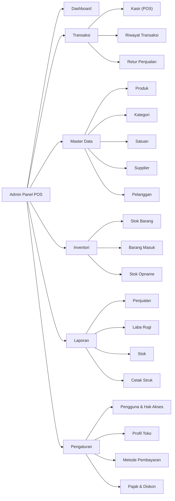
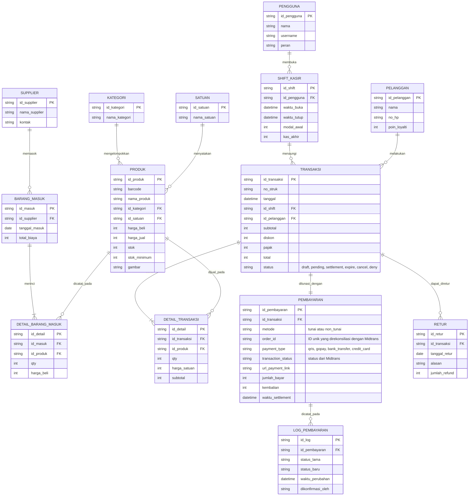
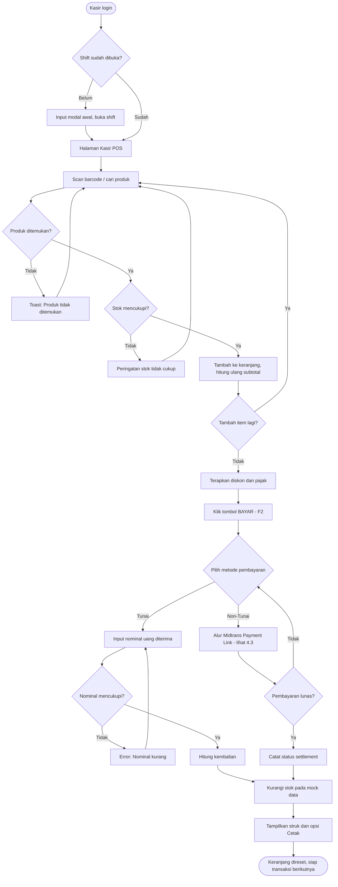
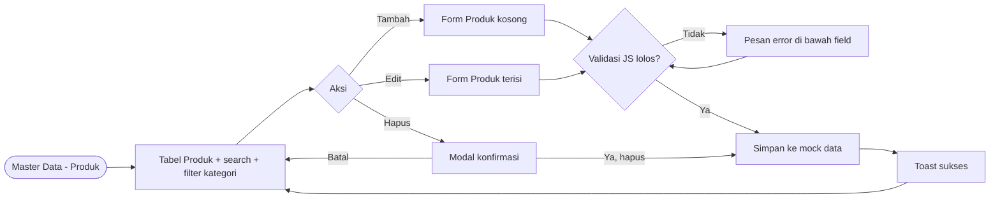
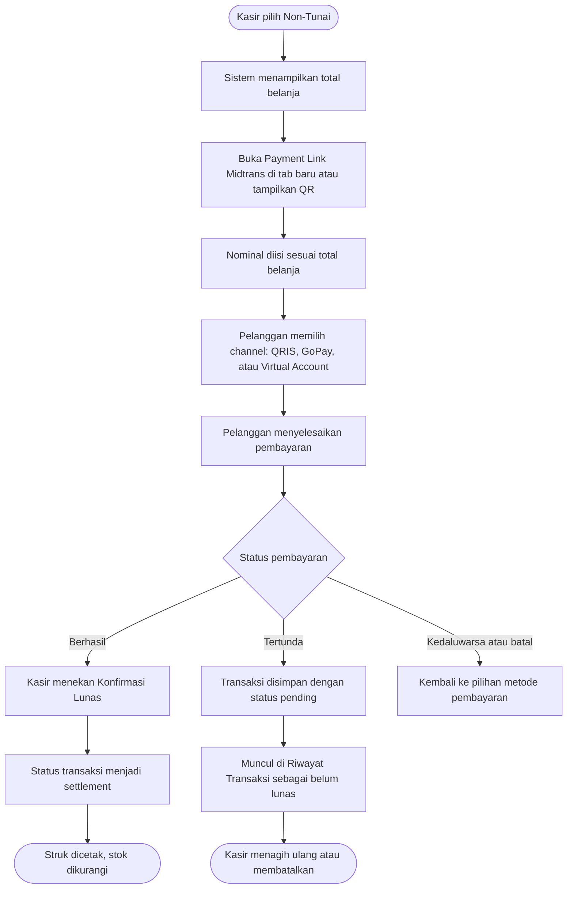
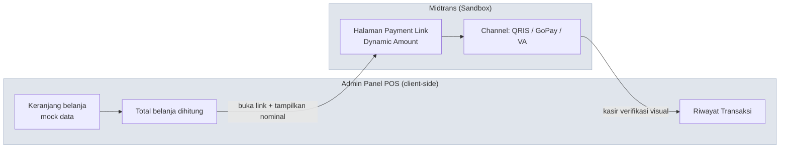

# PERANCANGAN — Admin Panel Point of Sales (POS / Kasir Toko)

> **Mata Kuliah:** Pemrograman Web 2 (Client-Side Programming)
> **Milestone:** 1 — Perencanaan Menu & UI Wireframing (Pekan Ke-3)

| Item | Keterangan |
| :-- | :-- |
| Nama | I GEDE YOGA SETIAWAN |
| NIM | 231011401028 |
| No. Presensi | 5 |
| Topik Sistem | Sistem Point of Sales (POS / Kasir Toko) |
| Tema Visual | **Neumorphism** (Soft UI) |
| Url Stitch | https://stitch.withgoogle.com/projects/11214029862213967469 |

---

## 1. Deskripsi Sistem

Admin Panel ini adalah *back-office* untuk sebuah toko retail. Sistem melayani dua kebutuhan yang karakternya berbeda, dan perbedaan itu memengaruhi keputusan desain di dokumen ini:

1. **Operasional kasir (front-line)** — transaksi harus selesai dalam hitungan detik. Halaman Kasir dioptimalkan untuk kecepatan: target sentuh besar, jalur keyboard, minim klik.
2. **Manajerial (back-office)** — pemilik toko memantau stok, penjualan, dan laba. Halaman ini dioptimalkan untuk keterbacaan data padat.

Seluruh data pada tugas ini bersifat **mock data** (client-side, tanpa back-end).

**Pengecualian: pembayaran non-tunai.** Sistem diintegrasikan dengan payment gateway **Midtrans** melalui skema *Payment Link* yang tidak membutuhkan back-end. Rinciannya dibahas di Bagian 5.

---

## 2. Hirarki Menu (Sidebar / Navbar)

```
Admin Panel POS
│
├── 📊 Dashboard
│
├── 🛒 Transaksi
│   ├── Kasir (POS)              <- halaman operasional utama
│   ├── Riwayat Transaksi
│   └── Retur Penjualan
│
├── 📦 Master Data
│   ├── Produk
│   ├── Kategori Produk
│   ├── Satuan
│   ├── Supplier
│   └── Pelanggan
│
├── 🏬 Inventori
│   ├── Stok Barang
│   ├── Barang Masuk (Purchasing)
│   └── Stok Opname
│
├── 📈 Laporan
│   ├── Laporan Penjualan
│   ├── Laporan Laba Rugi
│   ├── Laporan Stok
│   └── Cetak Struk / Ulang Struk
│
└── ⚙️ Pengaturan
    ├── Pengguna & Hak Akses
    ├── Profil Toko
    ├── Metode Pembayaran
    └── Pajak & Diskon
```

### 2.1 Diagram Hirarki Menu



### 2.2 Hak Akses per Peran

| Menu | Admin / Pemilik | Kasir |
| :-- | :--: | :--: |
| Dashboard | ✅ | ➖ (versi ringkas) |
| Kasir (POS) | ✅ | ✅ |
| Riwayat Transaksi | ✅ semua | ✅ shift sendiri |
| Retur Penjualan | ✅ | ⚠️ perlu approval |
| Master Data | ✅ | ❌ |
| Inventori | ✅ | 👁️ lihat saja |
| Laporan | ✅ | ❌ |
| Pengaturan | ✅ | ❌ |

---

## 3. Rancangan ER-D (Entity Relationship Diagram)



---

## 4. User Flow

### 4.1 Alur Utama — Proses Transaksi Kasir



### 4.2 Alur Pendukung — CRUD Master Produk



### 4.3 Alur Pembayaran Non-Tunai (Midtrans Payment Link)



> **Catatan keterbatasan:** karena tidak ada back-end, sistem tidak bisa menerima *webhook notification* dari Midtrans. Konfirmasi status karena itu dilakukan **manual oleh kasir** setelah memverifikasi pembayaran di layar Midtrans atau di dashboard. Pada sistem produksi, langkah ini digantikan oleh callback otomatis ke server. Keterbatasan ini disadari dan diterima sebagai konsekuensi dari batasan tugas *client-side only*.

---

## 5. Integrasi Payment Gateway (Midtrans)

### 5.1 Kendala Arsitektur dan Solusinya

Integrasi Midtrans yang umum memakai **Snap**, tetapi Snap **tidak dapat dipakai pada proyek client-side murni**. Alasannya: token Snap hanya bisa dibuat lewat permintaan ke Midtrans yang diautentikasi dengan **Server Key**, dan dokumentasi Midtrans menegaskan Server Key hanya boleh dipakai dari sisi server. Karena repositori tugas ini bersifat publik, menaruh Server Key di berkas JavaScript akan membocorkannya ke siapa pun yang membuka repositori.

Karena itu sistem memakai **Midtrans Payment Link** dengan fitur **Dynamic Amount**:

| Aspek | Snap | **Payment Link (dipakai)** |
| :-- | :-- | :-- |
| Butuh back-end | Ya | **Tidak** |
| Server Key di kode | Ya, wajib server-side | **Tidak sama sekali** |
| Pembuatan | Lewat API | **Manual dari dashboard** |
| Nominal | Dinamis via API | **Dinamis via input pengguna** |
| Detail item/SKU | Bisa dikirim | Tidak bisa |

### 5.2 Arsitektur Alur Data



Perhatikan tidak ada panah otomatis dari Midtrans kembali ke aplikasi. Rekonsiliasi status dilakukan manual oleh kasir, sesuai catatan pada Bagian 4.3.

### 5.3 Batasan yang Disadari

1. **Detail item tidak terkirim ke Midtrans.** Fitur Dynamic Amount tidak menerima rincian produk/SKU, sehingga Midtrans hanya memproses nominal. Rincian item tetap disimpan pada mock data lokal dan dicetak di struk aplikasi.
2. **Tidak ada rekonsiliasi otomatis.** Tanpa webhook, status pembayaran tidak dapat diperbarui sendiri.
3. **Hanya mode Sandbox.** Sistem tidak pernah memproses uang sungguhan. Akun production membutuhkan verifikasi bisnis dan tidak relevan untuk konteks tugas.

### 5.4 Aturan Keamanan

| Aturan | Alasan |
| :-- | :-- |
| **Server Key tidak pernah masuk repositori** | Repositori publik; Server Key dapat menyalahgunakan akun merchant |
| Hanya memakai kredensial **Sandbox** | Menghindari pemrosesan dana nyata |
| URL Payment Link disimpan di berkas konfigurasi terpisah | Memudahkan penggantian tanpa menyentuh logika aplikasi |
| Tidak menyimpan data kartu di sisi aplikasi | Seluruh input sensitif ditangani di halaman Midtrans |

### 5.5 Dampak pada Rancangan Antarmuka

- **Modal Pembayaran** bertambah pemilihan metode: *Tunai* dan *Non-Tunai*. Tunai tetap menampilkan input nominal dan kembalian; Non-Tunai menampilkan tombol buka Payment Link beserta QR.
- **Badge status transaksi** memakai tiga warna yang sudah didefinisikan pada Bagian 6.2: `settlement` memakai badge hijau, `pending` memakai badge kuning, `expire`/`cancel` memakai badge merah.
- **Halaman Riwayat Transaksi** memerlukan filter status agar transaksi *pending* mudah ditindaklanjuti.
- **Menu Pengaturan → Metode Pembayaran** dipakai untuk menyimpan URL Payment Link dan mengaktifkan/menonaktifkan metode non-tunai.

---

## 6. Design System — Neumorphism

### 6.1 Prinsip Neumorphism yang Dipakai

Neumorphism membangun kedalaman dari **dua bayangan berlawanan arah** pada permukaan sewarna dengan latar, bukan dari perbedaan warna. Konsekuensinya:

- Latar **tidak boleh** putih murni atau hitam murni — bayangan terang butuh ruang untuk terlihat.
- Semua permukaan memakai warna dasar yang sama (`--bg-base`); yang membedakan hanya arah bayangan.
- Sumber cahaya konsisten dari **kiri-atas** di seluruh aplikasi.

### 6.2 Color Palette

Base surface: **`#E0E5EC`**. Rasio di bawah dihitung terhadap base tersebut dan memenuhi **WCAG AA (minimal 4.5:1)**.

**Warna permukaan & bayangan**

| Token | HEX | Fungsi |
| :-- | :-- | :-- |
| `--bg-base` | `#E0E5EC` | Latar aplikasi & semua permukaan |
| `--shadow-light` | `#FFFFFF` | Bayangan kiri-atas (highlight) |
| `--shadow-dark` | `#A3B1C6` | Bayangan kanan-bawah |

**Warna teks & ikon di atas base**

| Token | HEX | Rasio kontras | Status |
| :-- | :-- | :--: | :--: |
| `--text-primary` | `#2D3748` | 9.47:1 | AAA |
| `--text-secondary` | `#4A5561` | 6.00:1 | AA |
| `--primary-text` | `#3550C9` | 5.28:1 | AA |
| `--success-text` | `#146B39` | 5.20:1 | AA |
| `--danger-text` | `#A8330F` | 5.27:1 | AA |
| `--warning-text` | `#755300` | 5.54:1 | AA |

**Warna isian tombol (teks putih di atasnya)**

| Token | HEX | Rasio vs putih | Dipakai untuk |
| :-- | :-- | :--: | :-- |
| `--btn-primary` | `#3550C9` | 6.68:1 | Simpan, Tambah |
| `--btn-success` | `#146B39` | 6.58:1 | Bayar, Konfirmasi |
| `--btn-danger` | `#C13D18` | 5.32:1 | Hapus, Batalkan |
| `--btn-neutral` | `#2D3748` | 11.99:1 | Cetak, aksi sekunder |

**Warna badge status stok**

| Status | Warna teks | Latar | Rasio |
| :-- | :-- | :-- | :--: |
| Stok aman | `#146B39` | `#CFE9DA` | 5.11:1 |
| Stok habis | `#A8330F` | `#F7DAD1` | 5.06:1 |
| Stok menipis | `#755300` | `#F7E7B8` | 5.70:1 |

> ⚠️ **Catatan penting:** `--shadow-dark` (`#A3B1C6`) hanya 1.72:1 terhadap base. Ini wajar dan disengaja, karena bayangan bukan pembawa informasi. Tapi artinya: **jangan pernah** menandai batas input, menu aktif, atau state error hanya lewat bayangan. Selalu tambahkan pembeda kedua berupa warna teks, ikon, atau border.

### 6.3 Typography

| Peran | Font | Size / Line-height | Weight |
| :-- | :-- | :-- | :-- |
| Display / angka besar | Poppins | 32px / 40px | 600 |
| H1 — judul halaman | Poppins | 28px / 36px | 600 |
| H2 — judul section | Poppins | 22px / 30px | 600 |
| H3 — judul card | Poppins | 18px / 26px | 500 |
| Body — teks umum | Inter | 16px / 24px | 400 |
| Small — label & tabel | Inter | 14px / 20px | 400 |
| Caption — helper text | Inter | 12px / 18px | 500 |

**Aturan khusus angka (kritis untuk POS):** semua harga, subtotal, dan total memakai `font-variant-numeric: tabular-nums;` supaya digit sejajar rata kanan dan mudah diperiksa sekilas. Total belanja di halaman Kasir memakai ukuran Display.

### 6.4 Spacing & Radius

- Skala spacing kelipatan **8px**: `4 · 8 · 16 · 24 · 32 · 48`
- Radius: tombol dan input `12px`, card `20px`, modal `24px` — radius besar memperkuat kesan *soft*
- Padding minimum permukaan neumorphic: `16px`, karena bayangan butuh ruang agar tidak terpotong

### 6.5 Resep Bayangan per State

| State | `box-shadow` |
| :-- | :-- |
| **Raised** (default: card, tombol) | `6px 6px 12px #A3B1C6, -6px -6px 12px #FFFFFF` |
| **Raised kecil** (badge, chip) | `3px 3px 6px #A3B1C6, -3px -3px 6px #FFFFFF` |
| **Pressed / Inset** (input, tombol aktif) | `inset 4px 4px 8px #A3B1C6, inset -4px -4px 8px #FFFFFF` |
| **Flat** (baris tabel) | `none`, hanya divider `1px solid #C9D2DE` |
| **Focus** (aksesibilitas) | `inset 4px 4px 8px #A3B1C6, inset -4px -4px 8px #FFFFFF, 0 0 0 3px #3550C9` |

### 6.6 Komponen Reusable (dibuat di Figma)

- [ ] **Button** — varian Primary / Success / Danger / Neutral / Ghost, dikali state default, hover, pressed, disabled
- [ ] **Form Input** — text, number, select, search dengan ikon barcode, dikali state default, focus, error, disabled
- [ ] **Card** — Stat Card (Dashboard), Product Card (grid kasir), Container Card
- [ ] **Sidebar Item** — state default, hover, active *(active wajib punya penanda warna, bukan hanya inset)*
- [ ] **Data Table** — header, row, row-hover, pagination, kolom aksi
- [ ] **Modal** — konfirmasi hapus dan modal pembayaran
- [ ] **Badge / Chip** — status stok dan status transaksi
- [ ] **Toast / Notifikasi**

### 6.7 Adaptasi Neumorphism untuk Konteks POS

Neumorphism berkontras rendah dan secara default kurang cocok untuk data padat. Tiga penyesuaian berikut diterapkan supaya tetap sesuai karakter POS (rubrik menilai "UI yang cepat untuk kasir"):

1. **Tabel tidak neumorphic per baris.** Hanya *container* tabel yang raised; barisnya flat dengan divider tipis. Kalau setiap baris diberi bayangan, tabel 20 baris jadi tidak terbaca.
2. **Tombol aksi utama memakai isian solid, bukan soft.** Tombol BAYAR memakai `--btn-success` solid dengan teks putih agar langsung terlihat, sementara tombol sekunder tetap neumorphic.
3. **Fokus keyboard selalu terlihat.** Ring `3px` warna primary di atas state inset, karena kasir bekerja dengan keyboard dan efek inset saja terlalu samar.

---

## 7. Hasil Wireframing (Stitch by Google)

> Ganti placeholder di bawah dengan screenshot hasil kerja di Stitch, dan simpan file gambarnya ke folder `img/`.

**Link project Stitch:** _(tempel link di sini)_

| Layar | Screenshot |
| :-- | :-- |
| Wireframe Dashboard | `` |
| Wireframe Halaman Kasir | `` |
| Wireframe Data Master Produk | `` |
| Peta User Flow | `` |

---

## 8. High-Fidelity UI Design (Figma)

> Set share permission ke **Anyone with the link → can view**. Kalau masih *restricted*, dosen tidak bisa membuka file dan poin Design System hilang.

**Link publik Figma:** _(tempel link di sini)_

| Halaman | Screenshot |
| :-- | :-- |
| Design System (palette, tipografi, komponen) | `` |
| High-Fidelity Dashboard | `` |
| High-Fidelity Data Master | `` |

---

## 9. Rencana Halaman untuk Milestone 3

| # | Halaman | File | Isi Utama |
| :--: | :-- | :-- | :-- |
| 1 | Dashboard | `pages/dashboard.html` | 4 stat card (omzet hari ini, jumlah transaksi, produk terjual, stok menipis) + grafik Chart.js penjualan 7 hari + tabel transaksi terakhir |
| 2 | Data Master | `pages/data-master.html` | Tabel produk dengan search, filter kategori, badge stok, tombol Tambah/Edit/Hapus |
| 3 | Form Input/Edit | `pages/form-produk.html` | Form produk dengan validasi JS: nama wajib, harga jual harus lebih besar dari harga beli, stok tidak boleh negatif |
| 4 | Laporan / Detail | `pages/laporan.html` | Rekap penjualan per periode dan tampilan struk siap cetak dengan `@media print` |
| + | Kasir (nilai tambah) | `pages/kasir.html` | Grid produk, panel keranjang, dan modal pembayaran dua metode (Tunai / Non-Tunai Midtrans) |

> **Urutan pengerjaan:** empat halaman wajib diselesaikan lebih dahulu. Integrasi Midtrans dikerjakan sesudahnya sebagai nilai tambah, karena tidak termasuk komponen yang dinilai pada rubrik.

---

## 10. Checklist Pengumpulan Milestone 1

- [ ] Identitas di bagian atas dokumen sudah diisi
- [ ] Hirarki menu lengkap sampai sub-menu
- [ ] Diagram ER-D memakai sintaks Mermaid *(bukan screenshot)* dan render dengan benar di GitHub
- [ ] User flow tergambar jelas
- [ ] Design System memuat color palette, typography, dan daftar komponen
- [ ] Wireframe dibuat di **Stitch** dan screenshot-nya sudah di-embed
- [ ] Design System serta Hi-Fi Dashboard & Data Master dibuat di **Figma**
- [ ] Link Figma sudah publik dan sudah dicoba dibuka lewat jendela incognito
- [ ] Semua gambar di `img/` ikut ter-commit *(cek tidak ada gambar broken setelah push)*
- [ ] Rancangan integrasi Midtrans terdokumentasi di Bagian 5
- [ ] Dipastikan tidak ada Server Key atau kredensial apa pun di dalam repositori
- [ ] Push ke GitHub/GitLab, lalu kirim link repo ke LMS Mentari
